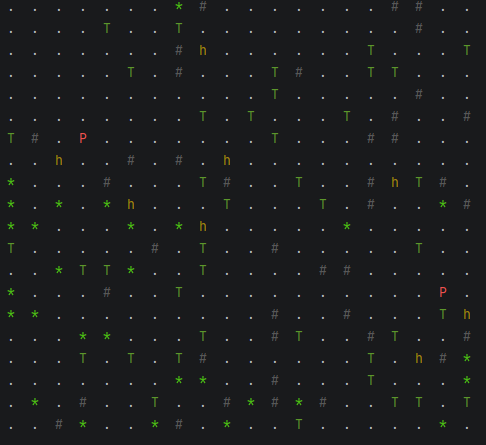

https://github.com/klescevg/simulation  
[распознаётся графически]

В целом ок.

## ХОРОШО

+ 👍 Есть пауза/пуск во время работы
+ 👍 Спрайты существ не хранятся в самих существах
+ 👍 Координаты существ не хранятся в самих существах (мне так больше нравится)
+ 👍 Несколько алгоритмов поиска: BFS, A*
+ 👍 Точки расширения в проекте через использование интерфейсов: поиск, рендерер.
+ 👍 Оригинальная распечатка карты: цветными буквами  
 

Прикольное решение: ландшафт серый, а существа - цветные. 

## ЗАМЕЧАНИЯ

**1. Нейминг**

- Согласовывай названия между собой.

Если возвращаешь "neighbors", то возвращай "neighbors"
```java
public static Set<Coordinate> getNeighbors(WorldMap map, Coordinate coordinate) {
  Set<Coordinate> neighborsInBounds = new HashSet<>();
  //...
  return neighborsInBounds;
}

//ПРАВИЛЬНО:
public static Set<Coordinate> getNeighbors(WorldMap map, Coordinate coordinate) {
  Set<Coordinate> neighbors = new HashSet<>();  
  //...
  return neighbors;
}
```

*Oracle Java code conventions, part."Naming conventions"*  
*Мартин, "Чистый код", гл.2*  
*Ютуб, Немчинский "Как называть переменные, методы и классы?"*

**2. record Coordinate**

+ 👍 Нет ничего лишнего, это хорошо. Record для координаты- идеально
```java
public record Coordinate(int row, int column) {
}
```

**3. class CoordinateGenerator**

Смысла в существовании этого класса я не вижу.  
Метод нахождения случайной координаты нужен только классу `SpawnEntitiesAction` и вполне может находиться там: 
нахождение случайной координаты эта часть его ответственности по заселению существ на карту. 

Сейчас существование этого класса выглядит как антипаттерн "Дробление"
```java
public class CoordinateGenerator {
    private static final Random RANDOM = new Random();

    public static Coordinate random(int bound){
        return new Coordinate(RANDOM.nextInt(bound), RANDOM.nextInt(bound));
    }
}
```

**4. class WorldMap**

- Необоснованные ограничения формы карты.

Не вижу причин для ограничивания карты формой квадрата
```java
public class WorldMap {
  private final int sideLength;
  //...

   public WorldMap(int sideLength) {...}
   //...
}

//ПРАВИЛЬНО:
public class WorldMap {
  private final int width;
  private final int height;
  //...

   public WorldMap(int width, int height) {...}
   //...
}
```
Ограничивать игровое поле какой-то формой можно только тогда, когда это определяется устоявшимися правилами игры.  
Например, шашки или "Крестики-нолики". 

+ 👍 При всех операциях с участием координаты, она валидируется. Это хорошо
```java
public void addEntity(Coordinate coordinate, Entity entity) {
  validate(coordinate);  <-- Если координата не в пределах карты, то бросает исключение IllegalArgumentException 
  entities.put(coordinate, entity);
}

public boolean isCellEmpty(Coordinate coordinate) {
  validate(coordinate);  <-- Если координата не в пределах карты, то бросает исключение IllegalArgumentException 
  return !entities.containsKey(coordinate);
}
```

+ 👍 Геттеры не возвращают null, они возвращают Optional, это хорошо.

- Метод совершения хода в карте- нарушение SRP.

Теперь можно вызвать из карты метод хода и телепортировать зайца из одного края в другой, минуя все правила игровой логистики
```java
public void moveEntity(Coordinate from, Coordinate to) {
  //Содержит часть общеигровой логики совершения хода:
  //координата from должна быть занята существом
  //координата to должна быть свободна
}
```
Должна ли карта учитывать правила логистики существ? Если да, то как?

Например, имеет ли право заяц телепортироваться на координату, которая уже занята?  
Может ли телепортироваться камень?  
Может ли телепортироваться пустое место на голову волка?

Метод частично отвечает на эти вопросы: он содержит часть правил выполнения хода существами.  
Тем самым единые правила выполнения хода существами разделяются на несколько классов: этот и совершающего ход существа.   

Правила совершения хода существами - это дополнительная причина для изменения этого класса.  
Поэтому карта вообще не должна иметь в себе этого метода.

+ 👍 В целом с точки зрения SOLID класс хороший. Если перенести из него телепортацию, то будет вообще идеальным.

**5. class WorldMapUtils**

+ 👍 В этот класс вынесены вспомогательные методы для работы с картой, это хорошо.

Методы: найти в карте всех существ определенного типа; найти все соседние координаты, входящие в карту etc.

+ 👍 Это утилитный класс и он соответствует требованиям для утилитных и константных классов
```java
public final class WorldMapUtils {  <-- final

  private WorldMapUtils() {  <-- закрытый конструктор
  }

  //статичные методы
}
```

Невозможно унаследоваться от этого класса или сделать его экземпляр, это хорошо.  
*Блох, "Java. Эффективное программирование", изд.3, гл.2.4*

- Повторяющиеся действия делай циклами
```java
public static Set<Coordinate> getNeighbors(WorldMap map, Coordinate coordinate) {
  Coordinate left = new Coordinate(coordinate.row(), coordinate.column() - 1);
  Coordinate right = new Coordinate(coordinate.row(), coordinate.column() + 1);
  Coordinate top = new Coordinate(coordinate.row() - 1, coordinate.column());
  Coordinate bottom = new Coordinate(coordinate.row() + 1, coordinate.column());

  List<Coordinate> allNeighbors = List.of(left, right, top, bottom);
  Set<Coordinate> neighborsInBounds = new HashSet<>();

  for (Coordinate neighbor : allNeighbors) {
    if (map.isInBounds(neighbor)) {
      neighborsInBounds.add(neighbor);
    }
  }
  return neighborsInBounds;
}

//ПРАВИЛЬНО:

private static final List<Coordinates> SHIFT_COORDINATES = List.of(new Coordinate(0, -1), ...);

public static Set<Coordinate> getNeighbors(WorldMap map, Coordinate coordinate) {
  Set<Coordinate> neighborsInBounds = new HashSet<>();

  for (Coordinate shift : SHIFT_COORDINATES) {
    Coordinate neighbor = new Coordinates(coordinate.row() + shift.row(), coordinate.column() + shift.column());
    if (map.isInBounds(neighbor)) {
      neighborsInBounds.add(neighbor);
    }
  }
  return neighborsInBounds;
}
```

**6. class Path**

Класс для хранения найденного пути.  

Мне кажется, это несколько избыточно по сравнению с представлением пути в виде простого `List<Coordinates>`.  
Но почему бы и нет, если хочется.

**7. interface PathfindingStrategy**

+ 👍 Интерфейс поиска пути- это хорошо. Теперь можно делать разные реализации поиска: BFS, A* и т.д.

- Нейминг.

"Стратегия" это название стандартного паттерна, а кастомный интерфейс `PathfindingStrategy` не имеет отношения к этому паттерну.  
Поэтому лучше его так не называть, чтобы своим названием не вводить в заблуждение.

Да, любой интерфейс предполагает разные реализации, но это простой полиморфизм, а не паттерн "Стратегия". 

+ 👍 Сигнатура метода поиска ок. Сразу понятно, как пользоваться классом
```java
Path find(WorldMap map, Coordinate start, Class<? extends Entity> targetType);
```

**8. Два класса - реализации поиска: BFS и AStar**

+ 👍 Два алгоритма поиска, взаимозаменяемых в программе благодаря полиморфизму 
```java
public class AStarStrategy implements PathfindingStrategy {
  @Override
  public Path find(WorldMap map, Coordinate start, Class<? extends Entity> targetType) {...}
}

public class BfsStrategy implements PathfindingStrategy {
  @Override
  public Path find(WorldMap map, Coordinate start, Class<? extends Entity> targetType) {...}
}
```

**9. abstract class Entity и его простые наследники Tree/Rock/Grass**

+ 👍 Простые неходячие наследники без состояния и поведения - идеально
```java
public abstract class Entity {
}

public class Tree extends Entity {
}
```

**10. abstract class Creature extends Entity**

- Не вижу причин для разных подходов при хранении скорости и хранении типа еды
```java
public abstract class Creature extends Entity {
  private final int speed;
  //...

  protected abstract Class<? extends Entity> getTargetType();
}

//ПРАВИЛЬНО:
public abstract class Creature extends Entity {
  private final int speed;
  protected final Class<? extends Entity> targetType;
  //...
}
```

- Неподходящий тип исключения.

Существо находится в легальном состоянии. Просто этого существа нет в карте
```java
public final void makeMove(WorldMap map, PathfindingStrategy strategy) {
  Coordinate currentCoordinate = map.getCoordinate(this)
        .orElseThrow(() -> new IllegalStateException("Entity %s is not found on map".formatted(this.getClass().getSimpleName())));
  //...
}      
```

`IllegalStateException` нужно бросать, когда объект находится в непригодном для работы с ним состоянии.  
Например, когда его поля не инициализированы.

+ 👍 В целом класс ок. Принципиальных замечаний к нему нет.

**11. Наследники Creature: Заяц и Волк**

+ 👍 Всё ок.

**12. record SimulationConfig**

- Неправильное использование типа данных `record`.

Тип `record` задуман как простой контейнер данных, он должен использоваться именно в этом качестве.  
У record'ов не должно быть сложного поведения: [JEP 395: Records](https://openjdk.org/jeps/395)
```
Goals
Devise an object-oriented construct that expresses a simple aggregation of values.
Help developers to focus on modeling immutable data rather than extensible behavior.
```

У `SimulationConfig` есть сложное поведение: хитрая логика в методах.

Если нужен класс с развитым поведением, то просто создай обычный класс.

- Конфиг должен быть только контейнером с данными.  

Конфиг не должен заполнять данными сам себя.  
Какой-то сторонний класс должен заполнять конфиг данными: фабрика или типа того.

Именно эта условная фабрика должна знать сложные правила заполнения конфига данными, вроде этого
```java
throw new IllegalArgumentException("mapSideLength must be between 1 and " + MAX_SIDE_LENGTH + ", but was " + mapSideLength);
```

То есть должно быть разделение ответственностей: хранение конфигурационных данных и заполнение этих данных.

Сейчас уже есть класс-создатель конфига: `SimulationConfigProvider`. Вот он и должен инкапсулировать в себе всю эту сложную логику заполнения конфига. 

**13. interface Action**

+ 👍 Идеально
```java
public interface Action {
  void execute(WorldMap map);
}
```

**14. Классы - экшены**

+ 👍 Всё супер.

**15. Фабрики существ**

Есть целый пакет с фабриками существ.

Все они выглядят как дублирование конструктора существ:
```java
public class PredatorFactory implements EntityFactory{
  private final int healthPoints;
  private final int speed;
  private final int attackPower;

  public PredatorFactory(int healthPoints, int speed, int attackPower) {
      this.healthPoints = healthPoints;
      this.speed = speed;
      this.attackPower = attackPower;
  }

  public Predator create(){
      return new Predator(healthPoints, speed, attackPower);
  }
}
```

Антипаттерн "Полтергейст".

**16. interface Renderer**

+ 👍 Интерфейс рендерера - это хорошо.

Теперь можно делать разные рендереры для разных визуальных сред (консоль, интерфейс виндовс, http, матричный принтер etc)  
и разного отображения информации (цветной, черно-белый и пр.)

**17. class ConsoleRenderer implements Renderer**

+ 👍 Печатает цветными буквами.

+ 👍 В целом ок.

Но если у тебя всё равно полиморфизм с использованием интерфейса, то я бы сделал так:
```java
public class ConsoleRenderer implements Renderer {
  //Печатает черно-белыми буквами
} 

public class ColorConsoleRenderer extends ConsoleRenderer {
  private static final String ANSI_DEFAULT = "\033[39m";
  //...

  //Печатает цветными буквами
}  
```
Тогда, используя полиморфизм интерфейса `Renderer`, можно делать майны с разными рендерерами: монохромным или цветным. 

- Неподходящий тип исключения
```java
throw new IllegalStateException("Missing sprite for entity type: " + entity.getClass().getSimpleName());
```

**18. class Simulation**

+ 👍 Принимает в конструктор достаточное количество зависимостей, в том числе списки действий.  
Это позволяет делать майны с разными игровыми конфигурациями, не меняя код в классе `Simulation`
```java
public Simulation(WorldMap map, Renderer renderer, List<Action> initActions, List<Action> turnActions) {...}
```

**19. class SimulationController**

- Нейминг.

Название вводит в заблуждение. 

Учитывая, что в проекте есть классы `Simulation` и `SimulationController`, то кажется, то `SimulationController` это контроллер, а просто `Simulation` это модель.  
Но на самом деле, они оба контроллеры: одновременно работают и с моделями и с представлениями.  

Я бы этот класс назвал менеджером, запускатором или как-то типа того.

- Нарушение DI, высокая связность классов, не универсальность.

Класс не должен сам создавать симуляцию, он должен получать её в конструктор
```java
public class SimulationController {
  //...   
 
  public void runSimulation() {
    //...
  }

  private void initSimulation() {
    SimulationConfig config = new SimulationConfigProvider().getConfig();
    simulation = new SimulationFactory().create(config);
  }
}

//ПРАВИЛЬНО:
public class SimulationController {
  //... 

  public class SimulationController(Simulation simulation) {...}

  //...
}
```

Класс `SimulationController` не должен знать, откуда берётся экземпляр Simulation.  
Потому что одновременно он должен иметь возможность браться из разных мест.

Например так:
```java
public class FirstMain {
  public static void main(String[] args) {
    SimulationConfig config = new SimulationConfigProvider().getConfig();
    Simulation simulation = new SimulationFactory().create(config);

    SimulationController simulationController = new SimulationController(simulation);
    simulationController.runSimulation();
  }
}

public class SecondMain {
  public static void main(String[] args) {
    Simulation simulation = new AdditionalSimulationFactory().create();

    SimulationController simulationController = new SimulationController(simulation);
    simulationController.runSimulation();
  }
}

public class TestMain {  
  public static void main(String[] args) {

    WorldMap worldMap = new WorldMap(6, 6);
    worldMap.addEntity(new Заяц(), new Coordinates(0, 0));
    worldMap.addEntity(new Морковка(), new Coordinates(5, 5));

    Renderer renderer = new ConsoleОсенняяТайгаRenderer();

    List<Action> initActions = List.of();  // инит-экшенов не будет
    List<Action> turnActions = List.of(new MoveAction());  // будет только экшен хода - тестируем логистику

    Simulation simulation = new Simulation(worldMap, renderer, initActions, turnActions);

    SimulationController simulationController = new SimulationController(simulation);
    simulationController.runSimulation();
  }
}
```

## ВЫВОД

Немного перемудрил с конфигами и тем самым сделал архитектуру менее ясной и более громоздкой - лучше бы конфиги вообще убрать.  
Но в целом ок 👍

n.178(381)  
#ревью #симуляция  