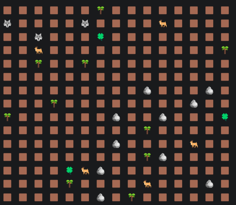

https://github.com/bltntJ/SimulationGG  
[топ]

В целом удручающе. Но молодец, что при всех недостатках реализации довёл её до работоспособного состояния👍  
Работа программы не полностью соответствует ТЗ. 

## НЕДОСТАТКИ РЕАЛИЗАЦИИ

1. В программе не реализована работа с потоками и выполнение старт/стоп во время работы симуляции.  
Хотя это требование есть в ТЗ. 

## ХОРОШО

+ 👍 Спрайты существ не хранятся в самих существах
+ 👍 Симпатичная распечатка карты:  
   

## ЗАМЕЧАНИЯ

**1. Нейминг**

- Этот метод помещает не Entity
```java
void setEntity(Coordinates coordinates, Creature creature) {
  creature.setCoordinates(coordinates);
  entities.put(coordinates, creature);
}

//ПРАВИЛЬНО:
void setCreature(Coordinates coordinates, Creature creature)
```

- Этот метод помещает не Object.  

Хотя, классы `Entity` неявно наследуются от класса `Object`, в этот метод нельзя передать любой `Object`.  
Можно передать только любой `Entity`
```java
public void setObject(Coordinates coordinates, Entity entity) {
  entity.setCoordinates(coordinates);
  objects.put(coordinates, entity);
}

//ПРАВИЛЬНО:
public void setEntity(Coordinates coordinates, Entity entity)
```

- Это не сеттер.

Сеттер должен устанавливать значение какого-то конкретного поля.  
А этот метод не устанавливает конкретное существо, он добавляет существо в группу других существ:
```java
private final HashMap<Coordinates, Creature> entities = new HashMap<>();

public void setEntity(Coordinates coordinates, Creature creature) {
  creature.setCoordinates(coordinates);
  entities.put(coordinates, creature); <-- ДОБАВЛЯЕТ объект, а не устанавливает его значение 
}

//ПРАВИЛЬНО:
void putEntity(Coordinates coordinates, Entity entity) //или addEntity(...)
```

Когда есть какое-то ОДНО существо, то сеттер корректен. Условный пример:
```java
private Entity entity; <-- Поле, в котором УСТАНАВЛИВАЕТСЯ значение

void setEntity(Entity entity) {
  this.entity = entity;  <-- Правильно, сеттер устанавливает конкретное значение
}
```

Когда существо добавляется к другим, то это не сеттер. Условный пример:
```java
private List<Entity> entities;  <-- Поле, в которое ДОБАВЛЯЕТСЯ значение

void addEntity(Entity entity) {
  entities.add(entity);  <-- Это не сеттер, потому что добавляет новый объект в список других
}
```

- Этот класс ничего не вводит - то есть не получает от юзера ввод данных и не возвращает их клиенту. Поэтому не должен называться "Input"
```java
public class InputReader implements Runnable {
  private final Scanner scanner = new Scanner(System.in);

  @Override
  public void run() {...}
}
```

- Поля нельзя называть как константы, даже если это аббревиатуры
```java
protected Integer HP;

//ПРАВИЛЬНО:
protected Integer hp;
```

*Oracle Java code conventions, part."Naming conventions"*  
*Мартин, "Чистый код", гл.2*  
*Ютуб, Немчинский "Как называть переменные, методы и классы?"*

**2. Форматирование**

- Мысленные преобразования.

Не вставляй перевод строки в `println`.  
Иначе при чтении кода приходится мысленно "разворачивать" одну строку в несколько.  
Если нужно распечатать несколько строк, то печатай их или многострочными строками(""") или отдельными инструкциями печати.  
Тогда сразу будет видно, как текст будет выглядеть на печати:
```java
System.out.println("--- Moves: " + count + " ---\n"); 

//ПРАВИЛЬНО:
System.out.println("--- Moves: " + count + " ---"); 
System.out.println();
```

- Форматирование строк.

Если нужно печатать или создавать строку с более чем одним подстановочным значением или значение вставляется внутрь сообщения, 
используй форматирование - тогда сразу будет виден весь шаблон сообщения
```java
System.out.println("--- Moves: " + count + " ---\n"); 

//ПРАВИЛЬНО:
System.out.printf("--- Moves: %d ---  \n", count); 
System.out.println(); 
```
Вставлять перевод строки один раз в конце `printf` - это нормально.

**3. Используй классы через их интерфейсы**
```java
HashMap<Coordinates, Creature> entities = new HashMap<>();

//ПРАВИЛЬНО:
Map<Coordinates, Creature> entities = new HashMap<>();
```
Общее правило: ArrayList нужно использовать через List, HashMap через Map, HashSet через Set и т.д.  
Это позволяет пользоваться преимуществами полиморфизма.

Да, бывают ситуации, когда, например, с LinkedList нужно работать именно как с LinkedList, а не с List. 
Но это уже нюансы.  
*"Java. Эффективное программирование", изд.3, гл.9.8*
```java
"Если вы выработаете привычку использовать в качестве типов интерфейсы, ваша программа будет гораздо более гибкой" - Блох
```

**4. Если в блоке if есть return(break, continue, throw, exit и т.д.), то else не пишется**

В этом случае неважно, будет else или нет, так как программа будет работать одинаково, а код без else будет выглядеть читабельней
```java
if (number.equals("0")) {
  System.out.println("Exiting...");
   break;  <-- Если сработает break, то инструкция else никогда не выполнится
} else {
  System.out.println("Enter a correct option!");
}

//ПРАВИЛЬНО:
if (number.equals("0")) {
  System.out.println("Exiting...");
   break;  <-- Если сработает break, то инструкция else никогда не выполнится
} 
System.out.println("Enter a correct option!");
```

**5. Нарушение DRY**

Магические буквы, числа, слова. Вводи константы. 

- Совместная магия.

Если к одной и той же магической штуке обращаются два разных класса, то делай ее константой в одном из этих двух классов.  
Либо перенеси ее в третий класс и из первых двух классов обращайся к этим константам - эти данные должны быть синхронизированы между собой
```java
public class InputReader implements Runnable {

  public void run() {
    if (number.equals("0")) {  <-- МАГИЧЕСКОЕ ЧИСЛО
      System.out.println("Exiting...");
      //...
    }
  }
}

public class Simulation {

  private void startingMessage(MapRenderer mapRenderer) throws InterruptedException {
    //...
    System.out.println("To exit, enter 0");   <-- МАГИЧЕСКОЕ ЧИСЛО
  }
}
```

*Фаулер, "Рефакторинг", гл.8, "Замена магического числа символической константой"*  
*refactoring.guru, "Замена магического числа символьной константой"*

**6. Exceptions**

- Не бросай базовый exception. Конкретизируй ситуацию- бросай то исключение, которое подходит под этот конкретный случай
```java
try {
  startingMessage(mapRenderer);
} catch (InterruptedException e) {
  throw new RuntimeException(e);
}
```
*Хорстманн "Java. Библиотека профессионала", т.1, гл.11*
```java
"Не ограничивайтесь генерацией RuntimeException. 
Найдите подходящий подкласс или создайте собственный." - Хорстманн
```

**7. Нарушение конвенции кода**

- Скобочки.

В любой ситуации выделяй тело блока скобочками, даже если тело состоит из одной строки  
```java
if (!reader.isAlive()) isRunning = false;

//ПРАВИЛЬНО:
if (!reader.isAlive()) {
  isRunning = false;
}
```
Исключение - метод equals(), там де-факто разрешается после `if` не выделять блоки скобочками. 

*"Oracle Java Code Conventions"* 

### Пакет game

**8. record Coordinates**

+ 👍 Record для координаты- идеально.

Для простых классов-контейнеров данных лучше всего использовать особый тип класса: `record`.  
Record'ы по умолчанию умеют правильно делать `hashCode()`, `equals()` и `toString()`.  
Про возможности рекордов почитай [ТУТ](https://docs.oracle.com/en/java/javase/21/docs/api/java.base/java/lang/Record.html).

- При прочих равных, нужно использовать примитивный тип, а не класс-обертку
```java
record Coordinates(Integer row, Integer column)

//ПРАВИЛЬНО:
record Coordinates(int row, int column)
```
Для применения класса-обертки над примитивным типом данных, должна быть какая-то причина.  
Здесь использование обертки не дает ничего большего по сравнению с примитивом.

*Блох "Java. Эффективное программирование", изд.3, гл.9.5*
```java
"Предпочитайте примитивные типы упакованным примитивным типам" - Блох
```

- Нарушение SRP.

Класс координаты не должен проверять, можно сдвинуть координату или нет
```java
public boolean canShift(Coordinates shift, Integer height, Integer width) {
  //определяет, будет ли сдвинутая координата находиться внутри заданной прямоугольной области (карты)    
}
```

Потому что класс координаты отвечает за идентификацию положения точки в пространстве.  
А проверка возможности сдвигания точки относится к чьей-то чужой ответственности.  
Надо полагать - к ответственности нахождения пути в карте, для чего искать этот путь надо с учётом того, чтобы координаты пути были внутри самой карты.

+ 👍 Этот метод - норм
```java
public Coordinates shift(Coordinates shift) {
  return new Coordinates(row + shift.row(), column + shift.column());
}
```

Подобные арифметические действия над объектами (сдвинуть, сложить, вычесть) часто помещают в сами объекты, так что здесь всё ок.  
Располагать метод сдвига координаты в самой координате - хорошо.  
Не располагать этот метод в самой координате - тоже хорошо. 

**9. class SimulationMap**

- Эти поля должны быть примитивами
```java
public final Integer height;
public final Integer width;
```

- Нарушение SRP, OCP и ТЗ 

Карта должна работать со всеми хранимыми существами одинаково и не работать как-то по-особому с конкретными классами-наследниками Entity.  
Здесь карта хранит каждый вид существ в отдельной мапе
```java
private final HashMap<Coordinates, Creature> entities = new HashMap<>();  <-- ЛИШНЕЕ, УБРАТЬ
private final HashMap<Coordinates, Entity> objects = new HashMap<>();  <-- ОСТАВИТЬ ТОЛЬКО ЭТО, но переименовать в "entities"
```
Нарушение SRP: карта знает слишком много. 

Нарушение OCP: 
Класс открыт для изменений.  
При добавлении нового существа в проект, придётся добавлять в класс новый код для этого существа:
```java
private final HashMap<Coordinates, Bird> birds = new HashMap<>();  
```

Нарушение ТЗ:
```
Чеклист для самопроверки #
Проблемы и ошибки в коде:
Параллельные коллекции для разных типов существ (для каждого типа своя коллекция)
```

Для того, чтобы карта работала так, как надо, достаточно использовать только одну мапу:
```java
private Map<Coordinates, Entity> entities = new HashMap<>();
```

Просто подумай, как сделать карту, которая содержит в себе не несколько хешмап, а только эту одну. 

- Нарушение инкапсуляции, класс предоставляет клиентскому коду подробности внутреннего устройства и доступ к нему
```java
private final HashMap<Coordinates, Entity> objects = new HashMap<>();
 
public HashMap<Coordinates, Entity> getObjects() {
  return objects;
}
```

Чеклист ТЗ:
```java
Проблемы и ошибки в коде:
...
Недостаточная инкапсуляция - “протекающее” наружу внутреннее устройство класса Map (например, прямой доступ к коллекции ячеек) 
вместо набора методов с говорящими названиями (AddEntity, RemoveEntity, и так далее)
```

В данный момент клиентский код может выполнять любые операции с HashMap Карты напрямую, игнорируя допустимые картой способы. 
Например так
```java
Карта карта = new Карта();
<заселить карту существами>
карта.getObjects().clear(); //геноцид- удаление из карты всех существ, минуя дозволенные картой механизмы
```
Из-за этого класс является гибридом со всеми вытекающими последствиями: *"Чистый код", гл.6*

В таких случаях нужно возвращать не оригинал объекта, а его копию: 
```java
private final Map<Coordinates, Entity> entities = new HashMap<>();
 
public Map<Coordinates, Entity> getEntities() {
  return new HashMap<>(entities);
}
```

- В связи с предыдущим замечанием, нужно добавить в карту метод:
```java
public Entity getEntity(Coordinates coordinates) {...}
```

- При всех операциях с участием координаты (добавить, выдать, удалить и т.д.) нужно проверять координату на корректность  
```java
public void setObject(Coordinates coordinates, Entity entity) {
  entity.setCoordinates(coordinates);
  objects.put(coordinates, entity);
}

public void removeEntity(Coordinates coordinates) {
  entities.remove(coordinates);
}

//ПРАВИЛЬНО:
public void setObject(Coordinates coordinates, Entity entity) {
  validate(coordinates);  <-- Если координата не в пределах карты, то бросает исключение    
  entity.setCoordinates(coordinates);
  objects.put(coordinates, entity);
}

public void removeEntity(Coordinates coordinates) {
  validate(coordinates);  <-- Если координата не в пределах карты, то бросает исключение    
  entities.remove(coordinates);
}
```
Ближайшая аналогия- стандартные хранилища типа List и массива.  
При попытке обратиться к ним по несуществующему индексу, бросается исключение.

Сейчас можно вставить в карту существо на координату, которая находится за пределами карты.  
Например, на координату (-100500, +100500).
И там это существо будет жить своей невидимой жизнью.

+ 👍 В целом, хоть и есть нарушение SOLID, класс не настолько плох, как я ожидал.  
По крайней мере, сюда не навешано каких-то странных методов. 

**10. class MoveCounter**

- Нарушение SRP, чужая ответственность, зависимость модели от представления.

Модель (а это модель) не должна ничего печатать в консоль
```java
public class MoveCounter {
  private int count = 0;

  public void increaseCount() {
    count++;
    System.out.println("--- Moves: " + count + " ---\n");  <-- МОДЕЛЬ ПЕЧАТАЕТ В КОНСОЛЬ
  }
}
```
  
Иначе модель перестает быть универсальной и становится заточенной под конкретную среду и конкретное представление себя в этой среде- в данном случае, консоль.
В других средах нужно будет менять код в этом классе, чтобы вывод осуществлялся по правилам этой среды, то есть, это лишняя причина для изменения класса.
В других средах(напр. Андроид) эту модель нельзя будет использовать- она там просто не скомпилируется. 
Другое представление для модели(напр. если одну и ту же модель нужно в программе показывать по-разному) нельзя будет сделать, или придется делать через костыль.

Модель, которая зависит от представления, перестает быть моделью.  
Сейчас твой счетчик ходов может работать только в программе с консольным интерфейсом.

- Если убрать из этого класса печать в консоль, то возникнет вопрос - а нужен ли вообще класс `MoveCounter`.  
Потому что обычный примитив будет работать примерно так же:
```java
int count = 0;
//...
count++;
```

**11. class MapRenderer**

+ 👍 Спрайты существ хранятся здесь, а не берутся из самих существ, это хорошо.

- Этот класс не должен в себе хранить хешмапы существ и размеры карты в виде ПОЛЕЙ ЭКЗЕМПЛЯРА
```java
public class MapRenderer {
  private final HashMap<Coordinates, Creature> entities;
  private final HashMap<Coordinates, Entity> staticEntities;
  private final int height;
  private final int width;

  public MapRenderer(SimulationMap simulationMap) {
    this.entities = simulationMap.getEntities();
    this.staticEntities = simulationMap.getObjects();
    this.height = simulationMap.getHeight();
    this.width = simulationMap.getWidth();
  }
  //...
}
```

Сейчас такой рендерер может работать только потому, что класс `SimulationMap` некорректно возвращает свои внутренности:
```java
public class SimulationMap {
  private final HashMap<Coordinates, Entity> objects = new HashMap<>();
  //...

  //Карта протекает - это плохо
  public HashMap<Coordinates, Entity> getObjects() {
    return objects;
  }
}
```

Как только карта будет соблюдать инкапсуляцию и защищать своё внутреннее устройство, то работа рендерера в его текущем виде поломается:
```java
public class SimulationMap {
  private final Map<Coordinates, Entity> entities = new HashMap<>();
  //...

  //Карта НЕ протекает - это хорошо
  public Map<Coordinates, Entity> getEntities() {
    return new HashMap<>(entities);
  }
}
```

Класс должен или хранить в себе только карту симуляции, а нужные данные из нее вытягивать на уровне метода, который использует карту:
```java
public class MapRenderer {
  private final SimulationMap simulationMap;

  public MapRenderer(SimulationMap simulationMap) {
    this.simulationMap = simulationMap;
  }

  public void render() {
    //...
    Map<Coordinates, Creature> entities = simulationMap.getEntities();
    Map<Coordinates, Entity> staticEntities = simulationMap.getObjects();
    //...
  }
}
```

Или, что еще лучше, карту принимать не в конструктор, а в метод - тогда класс будет более простым и универсальным:
```java
public class MapRenderer {

  public void render(SimulationMap simulationMap) {
    //...
    Map<Coordinates, Creature> entities = simulationMap.getEntities();
    Map<Coordinates, Entity> staticEntities = simulationMap.getObjects();
    //...
  }
}
```

- Не бойся использовать там, где уместно, названия индексов циклов, которые состоят более чем из одной буквы 
```java
for (int r = 0; r <= height; r++) {
  for (int c = 0; c <= width; c++) {
    Coordinates checkedCoordinate = new Coordinates(r, c);
  }
}

//ЛУЧШЕ:
for (int row = 0; row <= height; row++) {
  for (int column = 0; column <= width; column++) {
    Coordinates checkedCoordinate = new Coordinates(row, column);
  }
}
```

- Антипаттерн "Стрела".

Не должно быть больше 2-3 уровней вложенности.  
Если больше, это антипаттерн "Стрела", такой код очень труден для понимания
```java
for (int r = 0; r <= height; r++) {
  for (int c = 0; c <= width; c++) {
    if (entities.containsKey(checkedCoordinate)) {
      switch (creatureName) {
        //наконечник стрелы
      }
    }
  }
}
```
"Стрела" значит, что метод делает несколько дел сразу и его нужно разделить на несколько вспомогательных.
```java
"Если вам нужно более трех уровней вложенности, вы все равно запутались, так что исправьте программу" - Линус Торвальдс
```

- Делай код проще и понятнее - вводи вспомогательные методы
```java
public void render() {
  for (int r = 0; r <= height; r++) {
    for (int c = 0; c <= width; c++) {
      Coordinates checkedCoordinate = new Coordinates(r, c);
      if (entities.containsKey(checkedCoordinate)) {
        String creatureName = entities.get(checkedCoordinate).getClass().getSimpleName();
        switch (creatureName) {
          case "Herbivore" -> System.out.print(Config.HERBIVORE + " ");
          case "Tree" -> System.out.print(Config.TREE + " ");
          //...
        }
      }
    }
  }
}

//ПРАВИЛЬНО:
public void render() {
  for (int row = 0; row <= height; row++) {
    for (int column = 0; column <= width; column++) {
      Coordinates coordinates = new Coordinates(row, column);

      if(simulationMap.isEmpty(coordinates)) {
        //распечатать спрайт земли
      }  else {
        Entity entity = simulationMap.getEntity(coordinates);
        String sprite = toSprite(entity);
        //распечатать спрайт существа
      }
    }
    System.out.println();
  }
}

private String toSprite(Entity entity) {
  // Возвращает спрайт существа
  // если существо неизвестное - бросить исключение  
}
```

**12. class Simulation**

+ 👍 Принимает в конструктор карту, это хорошо
```java
public Simulation(SimulationMap simulationMap)
```

- Неправильное использование action's.

Экшены должны использоваться не персонально, а через коллекции. Должна быть возможность легко убрать экшен или добавить новый и единообразно использовать их через полиморфизм
```java
public class Simulation {
  private final TurnActionsMain turnActions;
  //...

  public Simulation(SimulationMap simulationMap) {
    //...
    new InitActionsMain(simulationMap).setDefaultPositions();
  }

    private void nextTurn() {
    doActions();
    //...
  }

  private void doActions() {
    turnActions.callCreaturesMover();
    turnActions.callCreaturesRemover();
  }
  //...
}

//ПРАВИЛЬНО:
public class Simulation {
  private final List<Action> initActions = List.of(new SpawnAction());
  private final List<Action> turnActions = List.of(new RemoveDeadEntityAction(), new MoveAction());
  //...

  public Simulation(SimulationMap simulationMap) {
    //...
    executeActions(initActions);
  }

    private void nextTurn() {
    executeActions(turnActions);
    //...
  }

  private void executeActions(List<Action> actions) {
    for(Action action : actions) {
      action.execute(simulationMap);
    }
  }
  //...
}
```

- Нет некоторых из указанных в ТЗ методов:
```java
Simulation #
Главный класс приложения, включает в себя:
...
nextTurn() - просимулировать и отрендерить один ход
startSimulation() - запустить бесконечный цикл симуляции и рендеринга
pauseSimulation() - приостановить бесконечный цикл симуляции и рендеринга
```
Эти методы там написаны не просто так, соблюдай ТЗ. Особенно, когда оно написано более опытным человеком, чем ты. 

- Публичные методы должны стоять выше вспомогательных им приватных методов.  
Сейчас единственный публичный метод стоит ниже всех.

- Неправильное использование потоков в проекте.

Внутри класса `Simulation` не должно быть никакой работы с потоками
```java
public class Simulation {
  private final Thread reader;  <-- Поток в симуляции
  //...
}
```

Этот класс не должен управлять потоками.  
Наоборот, какие-то потоки должны управлять этим классом и дергать за его публичные методы, которые указаны в ТЗ:
```java
Simulation #
Главный класс приложения, включает в себя:
...
nextTurn() - просимулировать и отрендерить один ход
startSimulation() - запустить бесконечный цикл симуляции и рендеринга
pauseSimulation() - приостановить бесконечный цикл симуляции и рендеринга
```

Это должен быть такой класс, который можно будет не только запускать из потоков.  
Но и запустить без потоков просто в бесконечном цикле и он должен бесконечно работать:
```java
public class Main {
  public static void main(String[] args) {
    GameMap gameMap = new GameMap(10, 10);
    //...
    Simulation simulation = new Simulation(gameMap, ...);
    simulation.startSimulation(); //бесконечная симуляция без потоков 
  }
}
```

Для этого класс должен выглядеть примерно так:
```java
public class Simulation {
  //...

  public Simulation(...) {
    //выполняет все initActions
  }

  public void nextTurn() {
    //выполняет все turnActions
    //печатает карту
    //печатает сопроводительную информацию: n.хода и прочее
  }

  public void startSimulation() {
    isRunning = true;
    while(isRunning) {
      nextTurn();
      sleep();
    }
  }

  private void sleep() {
    try {
      Thread.sleep(SLEEP_TIME);
    } catch (InterruptedException e) {...}
  }

  public void pauseSimulation() {
    //останавливает бесконечный цикл
  }
}
```

Когда мы добавляем в программу потоки, то поток должен принимать команды от юзера и дергать `Simulation` за ее методы:   
`nextTurn()`, `startSimulation()` и `pauseSimulation()`.

**Для тренировки можно сделать два Main'a в проекте.**

Один простой Main должен просто запустить симуляцию в бесконечном цикле без возможности управлять её работой через команды пауза/пуск.  
Примерно так:
```java
public class MainWithoutThreads {
  public static void main(String[] args) {
    GameMap gameMap = new GameMap(10, 10);
    //...
    Simulation simulation = new Simulation(gameMap, ...);
    simulation.startSimulation(); //бесконечная симуляция без потоков 
  }
}
```

По запуску второго симуляция должна работать с возможностью делать паузу/пуск.  
Примерно так:
```java
public class MainWithThreads {
  public static void main(String[] args) {
    GameMap gameMap = new GameMap(10, 10);
    //...
    Simulation simulation = new Simulation(gameMap, ...);

    SimulationManager manager = new SimulationManager(simulation);  //работает с потоками, дергает симуляцию за методы пауза/пуск 

    manager.start(); //симуляция с потоками и командами пауза/пуск
  }
}
```

### Пакет path

**13. class PathFinder implements MoveValidator**

- Нарушение SRP, спагетти код.

Почему вдруг поиск пути имеет папу в виде валидатора хода - загадка:
```java
class PathFinder implements MoveValidator
```

Это как унаследовать крокодила от трамвайного билета. 

- Неправильное использование утилитных классов. 

Папа этого класса, `MoveValidator`, является утилитой - содержит только статические методы.  
Утилитные классы, как и классы констант, должны быть `final` и иметь приватный конструктор.  
Не должно быть возможности унаследоваться от утилиты или сделать ее экземпляр.

*Блох, "Java. Эффективное программирование", изд.3, гл.2.4*

- Этот класс не ищет путь.

Путь - это последовательность точек от точки старта до точки финиша.  
Этот класс не ищет путь. Его единственный публичный метод возвращает одиночную координату
```java
public static Coordinates findNextStep(...) {...}
```
Этот метод ищет не путь, а ищет один шаг пути.  
Это тоже хорошо, но не то, что требуется от класса, который должен искать путь. 

Поиск пути должен просто искать путь от точки старта до точки, соответствующей заданным условиям согласно алгоритму BFS или A*.

В случае алгоритма BFS, поиск должен искать путь до точки, в которой находится существо нужного класса.  
Например простой BFS поиск-утилита:
```java
public final class BfsPathFinder {

  private BfsPathFinder() {}

  public static List<Coordinates> find(Карта карта, Coordinates start, Class<? extends Entity> target) {
  //ищет путь на карте от точки start
  //до точки, где находится существо нужного класса(напр. target == Grass.class)
  }
}
```

Клиенты должны использовать этот поиск примерно так:
```java
public abstract class Creature extends Entity {
  protected final Class<? extends Entity> food;
  //...

  public Creature(Class<? extends Entity> food, ...) {...}

  public void makeMove(SimulationMap simulationMap) {
    List<Coordinates> path = BfsPathFinder.find(simulationMap, coordinates, food); //текущая coordinates хранится на уровне Entity
    // Пройти по пути path текущее количество шагов до цели
  }
}

public class Herbivore extends Creature {
  private static final Class<? extends Entity> FOOD = Grass.class;
  //...

  public Herbivore(...) {
    super(FOOD, ...)
  }
  //...
}

public class Predator extends Creature {
  private static final Class<? extends Entity> FOOD = Herbivore.class;
  //...

  public Predator(...) {
    super(FOOD, ...)
  }
  //...
}
```

Или хотя бы так:
```java
public abstract class Creature extends Entity {
  //...

  public Creature(...) {...}

  public abstract void makeMove(SimulationMap simulationMap);
}

public class Herbivore extends Creature {
  private static final Class<? extends Entity> FOOD = Grass.class;
  //...

  public Herbivore(...) {
    super(...)
  }

  @Override
  public void makeMove(SimulationMap simulationMap) {
    List<Coordinates> path = BfsPathFinder.find(simulationMap, coordinates, FOOD);
    // Пройти по пути path текущее количество шагов до цели
  }
  //...
}

public class Predator extends Creature {
  private static final Class<? extends Entity> FOOD = Herbivore.class;
  //...

  public Predator(...) {
    super(...)
  }

  @Override
  public void makeMove(SimulationMap simulationMap) {
    List<Coordinates> path = BfsPathFinder.find(simulationMap, coordinates, FOOD);
    // Пройти по пути path текущее количество шагов до цели
  }
  //...
}
```

### Пакет utils

Содержит три утилитных класса. Каждый из них - какая-то лютая процедурщина с дженериками.  
Подробно разбираться с ними не имеет смысла, там всё плохо.  
При рефакторинге эти классы нужно просто удалить, а проект заново декомпозировать на классы.  

### Пакет elements

**14. abstract class Entity**

Обычно я против, чтобы в `Entity` хранилась координата - она, по моему мнению, должна храниться начиная с `Creature`
```java
protected Coordinates coordinates;
```
Но в твоём случае пусть будет хотя бы так - это проще.

**15. abstract class Creature extends Entity**

- Неправильное использование интерфейсов.

Интерфейсы, которые реализует `Creature`, сейчас содержат только дефолтные методы  
```java
abstract class Creature extends Entity implements StepFinder, MovesGetter {...}

//ПРАВИЛЬНО:
abstract class Creature extends Entity {...}
```

Эти интерфейсы здесь в принципе не задуманы для правильного использования в качестве интерфейсов - то есть для полиморфизма.
Фактически, эти интерфейсы выполняют роль утилитных классов 
```java
public interface MovesGetter {
  default List<Coordinates> getEntityMoves(int speed) {
    // 8 строк кода 
  }
}

public interface StepFinder {
  CellsGetter cellsGetter = new CellsGetter();  
  CoordinatesFinder coordinatesFinder = new CoordinatesFinder();

  default <T> Coordinates findStep(Class<T> targetClass, Creature creature, SimulationMap simulationMap, List<Coordinates> entityMoves, Coordinates coordinates) {
    //4 строки кода
  }
}
```

Методы из этих "интерфейсов" нужно либо перенести напрямую в класс `Creature`.  
Либо, после переделывания декомпозиции, перенести в другие классы.  
Например, логика нахождения соседних координат из `interface MovesGetter` должна быть перенесена в класс поиска пути.

**ЕЩЁ РАЗ:**  
Если ты делаешь интерфейс ТОЛЬКО для того, чтобы разместить в нём только default-методы, то фактически ты делаешь утилиту.

Происходит подмена контракта: интерфейс перестаёт описывать то, что нужно делать.  
Вместо этого он начинает хранить конкретный алгоритм того, КАК ИМЕННО это нужно делать. 

Имплементируя такой интерфейс в класс, ты фактически наследуешь этот класс от утилиты, что является антипаттерном.  
Разница только в том, что в этом случае такое утилитное наследование выглядит ПСЕВДО объектно-ориентированным.

НА ВСЯКИЙ СЛУЧАЙ:  
Само по себе использование `default` методов в интерфейсах не является чем-то плохим.  
Плохо, когда такие методы используют в неправильном контексте.  
Здесь - контекст неправильный.

Пока не разобрался с ООП на хоть сколько-то хорошем уровне, лучше вообще не делай default-методы в интерфейсах.

**16. class Herbivore/Predator extends Creature**

- Неправильное использование конфигурационного класса, нарушение Low Coupling.

Существо не должно самостоятельно лезть в конфиг и что-то оттуда считывать.  
Необходимые данные оно должно получать в конструктор
```java
public class Herbivore extends Creature {
  //...

  public Herbivore(...) {
    super(coordinates, Config.HERBIVORE_HEALTH, Config.HERBIVORE_SPEED);
  }
}

//ПРАВИЛЬНО:
public class Herbivore extends Creature {
  //...

  public Herbivore(..., int hp, int speed) {
    super(coordinates, hp, speed);
  }
}
```

- Нарушение DRY. Дублирование хранения одних и тех же данных у потомков
```java
public class Herbivore extends Creature {
  private final SimulationMap simulationMap;
  //...
}

public class Predator extends Creature {
  private final SimulationMap simulationMap;
  //
}

//ПРАВИЛЬНО:
public class Creature ... {
  protected final SimulationMap simulationMap;
  //...
}
```

- Циклическая зависимость.

Существа хранят в себе карту, а карта хранит в себе этих существ
```java
public abstract class Creature extends Entity implements StepFinder, MovesGetter {
  //...
  public abstract void makeMove();
}

public class Herbivore extends Creature {
  private final SimulationMap simulationMap;
  //...

  public void makeMove() {...}
}

public class Predator extends Creature {
  private final SimulationMap simulationMap;
  //

  public void makeMove() {...}
}

//ПРАВИЛЬНО:
public class Creature ... {
  //...
  public abstract void makeMove(SimulationMap simulationMap) {...}
}
```
По возможности избегай циклических зависимостей между классами.  
*Фаулер "Рефакторинг", гл.8, "Замена двунаправленной связи однонаправленной"*

### Пакет config

**17. class Config**

- Константный/конфигурационный класс в программе используется неправильно.

Другие классы напрямую лезут в этот константный класс.  
А должны только получать необходимые данные из константного класса в свой конструктор.  
Это делает классы не универсальными и зависимыми от константного класса.  

Условный пример:
```java
public class Settings {
  public static final int ROOMS = 5;
}

//ПЛОХО:
public static void main(String[] args) {
  House house = new House();
  //oth code
}

public class House {
  private final int rooms;

  public House() {
    this.rooms = Settings.ROOMS;
  }

  public int getRooms() {
    return rooms;
  }
}

//ХОРОШО:
public static void main(String[] args) {
  House house = new House(Settings.ROOMS);
  //oth code
}

public class House {
  private final int rooms;

  public House(int rooms) {
    this.rooms = rooms;
  }

  public int getRooms() {
    return rooms;
  }
}
```

Про классы констант, конфигурации и их использование я писал [ТУТ](https://t.me/zhukovsd_it_chat/53243/176984)

### Пакет actions.

ВСЁ СЖЕЧЬ НАПАЛМОМ. 

Классы в этом пакете - это не те actions, которые имеются ввиду в ТЗ. Это очередная процедурная вакханалия.

Идея Action's состоит в том, что нужно создать семейство родственных классов, объединенных общим интерфейсом.  
Каждый из этих классов должен делать что-то свое с картой: одна акция должна заселять карту существами, другая делать ходы и т.д.  
Action'ы, изложенные в ТЗ, это вариант реализации паттерна Command. 

В каждом экшене должен быть только один публичный метод (не публичных может быть сколько угодно).  
Это вариация паттерна Command- экшены должны быть родственны и одинаково использоваться через полиморфизм.  
Примерно так
```java
interface Action{
 void execute(Карта карта);
}

class ХодитьAction реализует Action {
  void execute(Карта карта) {
    //обойти всю карту
    //найти каждую креатуру
    //и дать ей пинка чтоб побежала
  }
}

class ДатьСигаретуВсемЗайцамAction реализует Action {
  void execute(Карта карта) {
    //обойти всю карту
    //найти всех зайцев и дать им по сигарете 
  }
}

List<Action> actions = List.of(new ДатьСигаретуВсемЗайцамAction(), new ХодитьAction());
for(Action a: actions) {
  a.execute(карта);
}

/*
Результат: программа обойдет всю карту, найдет всех креатур и даст им пинка, чтобы они побежали.
А каждому зайцу предварительно даст сигарету.
*/
```

Использоваться такие экшены в Симуляции должны одинаково через полиморфизм:
```java
public class Simulation {
  private final List<Action> initActions = List.of(new SpawnAction());
  private final List<Action> turnActions = List.of(new RemoveDeadEntityAction(), new MoveAction());
  //...

  public Simulation(SimulationMap simulationMap) {
    //...
    executeActions(initActions);
  }

    private void nextTurn() {
    executeActions(turnActions);
    //...
  }

  private void executeActions(List<Action> actions) {
    for(Action action : actions) {
      action.execute(simulationMap);
    }
  }
  //...
}
```

## ВЫВОД

В основном, в программе используются процедурные приёмы программирования.  

Например, вот такие блоки if-else используются там, где нужно использовать полиморфизм:
```java
if (searcherClass == Herbivore.class) {
  isTarget = simulationMap.getObjects().get(neighbor) instanceof Grass;
} else if (searcherClass == Predator.class) {
  isTarget = simulationMap.getEntities().get(neighbor) instanceof Herbivore;
}
```

Из той же серии:
```java
if (c1 instanceof Herbivore && c2 instanceof Predator) return -1;
  else if (c1 instanceof Predator && c2 instanceof Herbivore) return 1;
```

Слишком часто вместо нормальных объектно-ориентированных классов используются утилиты - это тоже типичный признак процедурного мышления.  
Пока не разобрался с ООП, лучше вообще не используй утилиты. Иначе неправильное их использование превращает программу в процедурный код.

Не видно понимания ООП на базовом уровне: зачем нужны интерфейсы и как их нужно использовать, зачем нужен полиморфизм.  
Не видно понимания ООП на уровне SOLID: смешивание разных ответственностей в разных классах.

Посмотри ролики Немчинского про SOLID: по одному ролику на каждый принцип
```
"SOLID принципы: SRP"
"SOLID принципы: OCP"
etc. 
```
Ролики короткие и нестрашные, как раз для новичков.

Вот ещё полезные ролики Немчинского для новичков:
```
"Правильные методы по Clean Code"
"Принцип хорошего кода KISS"
"Принцип хорошего кода DRY"
```

Делай только указанный в ТЗ функционал.  
Дополнительные усложнения, при недостаточном умении строить архитектуру программы, приносят больше вреда, чем пользы.  
Убери из программы конфиги и начальное конфигурирование размера карты - все это захламляет архитектуру, которая сейчас и так не очень хороша.

Придерживайся ТЗ.  
Если в нем указано, что нужно в классе сделать метод, то делай его.  
Соблюдение ТЗ - это важный навык для работы. 

Доделай программу согласно ТЗ: сделай паузу/пуск во время работы программы.  
Это важно для отработки азов работы с многопоточностью.

Подробнее разберись с Action'ами, посмотри ролики на ютубе про паттерн "Command", чтобы получить о нем общее представление.

Не видно и понимания декомпозиции - как делить программу на классы.  
Поэтому перед рефакторингом симуляции для лучшего понимания ООП декомпозиции посмотри ролики Сергея про шахматы.  

В твоём случае нужно не просто посмотреть, а повторить код за Сергеем.  
Да, потратишь на это ещё часов 20, но сделаешь первые шаги к пониманию объектно-ориентированного мышления.  
Сейчас твоё мышление чисто процедурное.

Нет ничего страшного в том, что ты написал проект плохо.  
Главное - сделать правильные выводы, понять свои слабые места и восполнить пробелы в знаниях.  
Но для этого ты должен проявить волю и усидчивость. Если забьёшь, то с таким багажом далеко не уедешь.

Эталонная версия Симуляции с объяснениями есть у Сергея в расширенных материалах.

n.179(383)  
#ревью #симуляция 